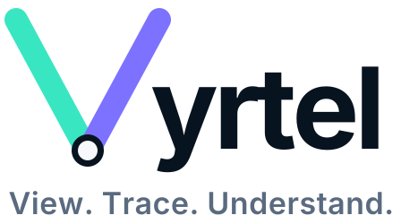
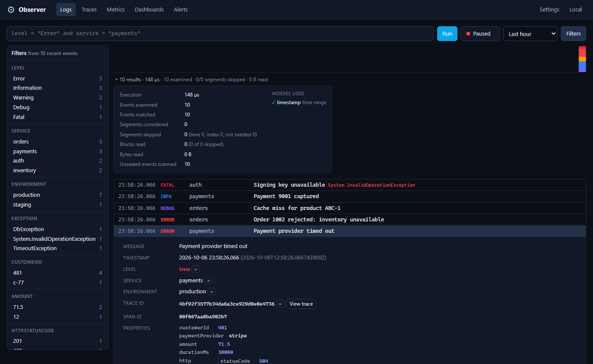
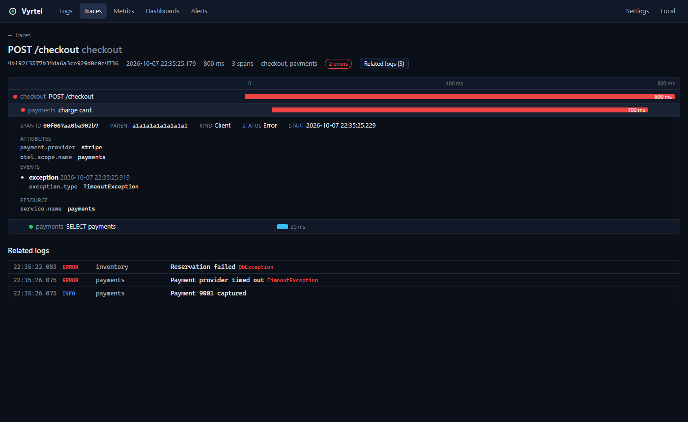
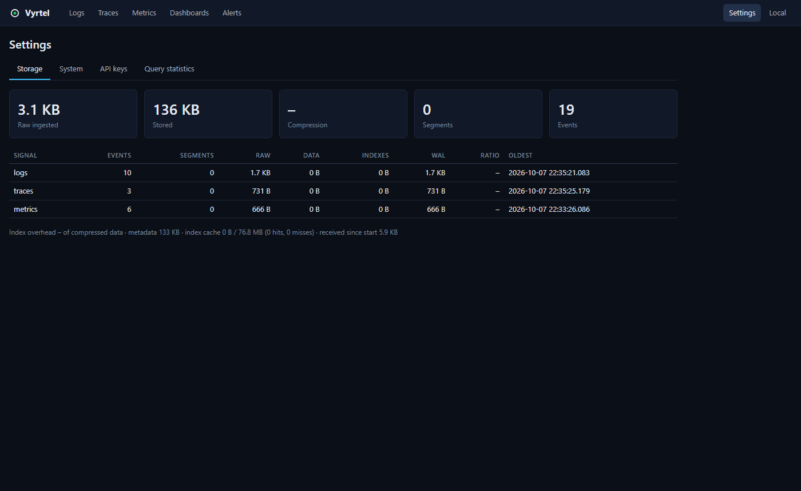

<p align="center">
  <picture>
    <source media="(prefers-color-scheme: dark)" srcset="docs/brand/vyrtel-lockup-tagline-dark.svg">
    
  </picture>
</p>

Small, fast, self-hosted observability. Structured logs, traces and
metrics in one small binary with one data directory and no external
services.

> Observability should not require more resources than the software being
> observed.

```
docker pull ghcr.io/rowan-smith/vyrtel:latest
docker run -p 8080:8080 -v vyrtel-data:/data ghcr.io/rowan-smith/vyrtel:latest
```

```
Vyrtel 0.1.1

Web UI              http://localhost:8080
Data directory      /data
HTTP                http://0.0.0.0:8080
OTLP HTTP           http://0.0.0.0:8080/v1/*
Storage             0 B
Memory limit        512 MB
Durability          normal
Connections         256 max (buffers up to 52.1 MB)
Authentication      login for the UI/API; ingestion open until an ingest API key is created

Admin login         admin / 3f9c2a7d41b08e6c5a2d9f10
                    (generated once; set auth.admin_password to choose your own)

Ready.
```

Open <http://localhost:8080> and you get **Logs · Traces · Metrics ·
Dashboards · Alerts**. No setup wizard, no database connection string, no
cluster configuration.



| Trace waterfall with related logs         | Storage statistics                       |
|-------------------------------------------|------------------------------------------|
|  |  |

(Regenerate with `SCREENSHOTS=1 npx playwright test screenshots` in `web/`.)

## What problem it solves

Most observability stacks need a search cluster, a time-series database, a
message queue and a few gigabytes of RAM before they show their first log
line. Vyrtel is for teams and side projects that want good structured-log
search, basic tracing and metrics **without operating infrastructure**:

* one process (HTTP API, OTLP ingestion, query engine, storage, metadata,
  web UI, background jobs);
* one data directory (`./data`), crash-safe, with bounded memory;
* bounded memory you set (`--memory-limit`, 512 MB by default).

## Features

* **Logs** (the hero feature): structured JSON/NDJSON ingestion (Serilog
  CLEF compatible), a small query language
  (`level = "Error" and http.statusCode >= 500`), live tail with
  pause/resume, vertical event inspection with exceptions and stack traces,
  filter panel with detected fields, compact histogram, and **query
  diagnostics** showing exactly which segments, blocks and indexes were used.
* **OpenTelemetry**: OTLP/HTTP for logs, traces and metrics (protobuf or
  JSON, gzip).
* **Traces**: search, waterfall view, span details, logs ↔ trace navigation.
* **Metrics**: counters, gauges and histograms with sum/count/min/max/avg/last
  and group-by, plotted over time.
* **Dashboards**: log count, metric line, single statistic and saved query
  panels on a simple grid.
* **Alerts**: log-count threshold alerts with OK/FIRING/ERROR state, history
  and webhook delivery.
* **Storage you can see**: append-only WAL with CRCs, immutable zstd
  segments with time ranges, bitmap indexes, Bloom filters and zone maps;
  compression ratio and index overhead are shown in Settings → Storage.
* **Operations**: per-signal retention, compaction, crash recovery,
  `strict`/`normal` durability, API keys, admin login, health/readiness
  endpoints, Docker image running as non-root.

## Quick start

### From source

Requirements: Rust (stable), a C compiler, Node.js 22+.

```bash
git clone <this repository> vyrtel && cd vyrtel
cd web && npm ci && npm run build && cd ..
cargo run --release -p server
```

### Docker

Prebuilt multi-arch images (amd64, arm64) are published with every release.
`latest` is the newest stable release; prereleases are only tagged with their exact version
(e.g. `0.1.2-rc.1`). Binaries and `SHA256SUMS` are on the
[releases page](https://github.com/rowan-smith/Vyrtel/releases); see
[docs/releasing.md](docs/releasing.md) for how releases are validated.

```bash
docker pull ghcr.io/rowan-smith/vyrtel:latest
docker run -p 8080:8080 -v vyrtel-data:/data ghcr.io/rowan-smith/vyrtel:latest
```

Or build the image yourself:

```bash
docker build -t vyrtel .
docker run -p 8080:8080 -v vyrtel-data:/data vyrtel
```

Keep `/data` on a named volume (as above) and the data survives
recreating or upgrading the container. For a bind mount such as
`-v ./vyrtel-data:/data` on Linux, run `sudo chown -R 65532:65532 vyrtel-data`
first: the image runs as the non-root uid 65532, and an unwritable directory
stops it with a hint saying so — see
[configuration](docs/configuration.md#docker-and-bind-mounts).

### Send your first event

```bash
curl -X POST http://localhost:8080/api/v1/events \
  -H 'content-type: application/json' \
  -d '{
    "level": "Error",
    "service": "payments",
    "message": "Payment failed",
    "traceId": "abc123",
    "properties": { "customerId": 481, "paymentProvider": "stripe", "amount": 71.50 },
    "exception": { "type": "TimeoutException", "message": "Payment provider timed out" }
  }'
```

…or point any OpenTelemetry SDK / Collector at it:

```bash
export OTEL_EXPORTER_OTLP_ENDPOINT=http://localhost:8080
export OTEL_EXPORTER_OTLP_PROTOCOL=http/protobuf
```

Want realistic data? `cargo run --release -p loadgen -- --rate 1000 --duration 60s --traces-every 200`.

### Run a query

Sign in to the UI as `admin` with the printed password, type
`level = "Error" and service = "payments"` and press Enter. Or, with an
admin API key from Settings → API keys:

```bash
curl -X POST http://localhost:8080/api/v1/query/logs \
  -H 'content-type: application/json' \
  -H 'Authorization: Bearer <admin key>' \
  -d '{"query": "customerId = 481 and message contains \"failed\"", "from": "-1h"}'
```

More examples:

```
durationMs > 500
http.statusCode >= 500 and not environment = "staging"
traceId = "4bf92f3577b34da6a3ce929d0e0e4736"
level >= Warning and (service = "orders" or service = "payments")
"timed out"
```

See [docs/query-language.md](docs/query-language.md).

## Documentation

The full documentation is on the website: **<https://rowan-smith.github.io/Vyrtel/docs/introduction.html>**

* [Quickstart](docs/guide/quickstart.md) · [Installation](docs/guide/installation.md) · [Docker](docs/guide/docker.md)
* [OpenTelemetry](docs/guide/opentelemetry.md) · [HTTP and JSON](docs/guide/http-ingestion.md) · [Query language](docs/query-language.md)
* [Security](docs/guide/security.md) · [Backups and upgrades](docs/guide/backups-and-upgrades.md)
* Reference: [configuration](docs/configuration.md), [HTTP API](docs/api.md), [architecture](docs/architecture.md), [storage format](docs/storage-format.md)
* [Benchmarks](docs/benchmarks.md): performance-gate results for the latest release

Working on Vyrtel itself: [development](docs/development.md), [testing](docs/testing.md),
[releasing](docs/releasing.md).

## Current limitations

* Single node only; no replication or clustering (by design for v0.1).
* OTLP over HTTP only (no gRPC). Exponential histograms and summaries keep
  only count/sum.
* `message contains` scans (no full-text index yet); no regex or wildcards.
* Metrics aggregation works on raw data points (no rate() for cumulative
  counters, no percentiles yet).
* Alerts: log-count thresholds with a generic webhook only.
* Authentication is a single admin user plus API keys. Ingestion is open
  until the first ingest key is created: create one before exposing Vyrtel,
  and terminate TLS in a reverse proxy ([security](docs/guide/security.md)).
* Retention is per signal at segment granularity.

## Roadmap

See the [roadmap](docs/roadmap.md) for planned milestones and the
[backlog](https://github.com/users/rowan-smith/projects/2).

## Contributing

Contributions are welcome. See [CONTRIBUTING.md](CONTRIBUTING.md) for how to get started. All
contributors sign a Contributor License Agreement once: the [Individual CLA](docs/cla/individual.md),
plus the [Corporate CLA](docs/cla/corporate.md) when contributing on behalf of an employer. The CLA
bot walks you through it on your first pull request.

## License

MIT — see [LICENSE](LICENSE).
