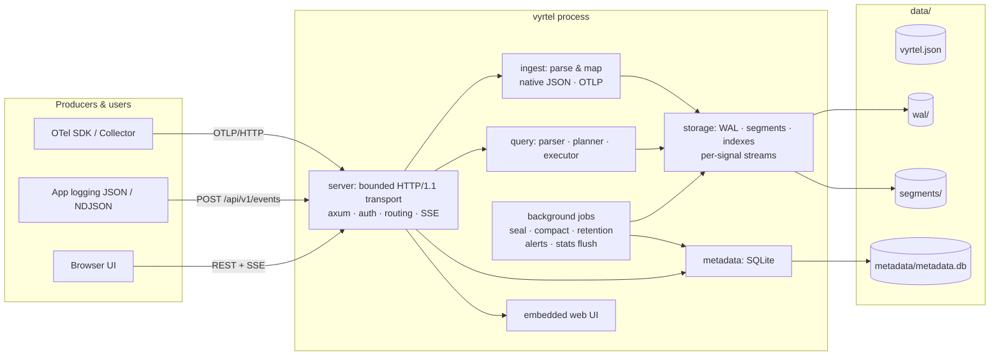
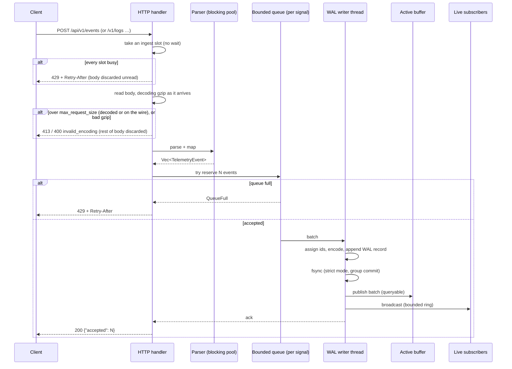
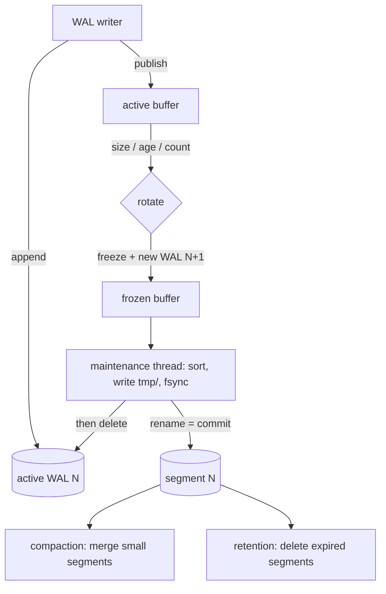

# Architecture

Vyrtel is **one process** with **one data directory**. Crates are code
boundaries, not network boundaries.

| Crate           | Responsibility                                                                                         | Depends on         |
|-----------------|--------------------------------------------------------------------------------------------------------|--------------------|
| `telemetry`     | Common event model (`TelemetryEvent`, `Fields`, `Value`), JSON view                                    | –                  |
| `storage`       | Event codec, WAL, segment format, indexes, recovery, sealing, compaction, retention, index cache       | telemetry          |
| `query`         | Lexer, parser, AST, evaluator, index pruning, executor, aggregations, traces, query stats              | telemetry, storage |
| `ingest`        | Native JSON/NDJSON and OTLP (protobuf + JSON) → `TelemetryEvent`                                       | telemetry          |
| `metadata`      | SQLite: schema and layout identity, settings, users/sessions, API keys, dashboards, saved queries, alerts, query stats | –                  |
| `server`        | Config, HTTP API, auth, live tail, alert evaluator, embedded UI, binary                                | all                |
| `tools/loadgen` | Load generator                                                                                         | –                  |

## Ingestion path

* Every queue is bounded: requests in progress (`ingest.max_concurrent`
  slots), events per signal (`queue_capacity`), the writer channel, and the
  live-tail ring.
* An ingest slot is held from before the body is read until the response is
  ready, so it bounds bodies, decoded events and requests awaiting their
  acknowledgement together. It is released however the request ends,
  including client disconnects; a request abandoned mid-parse keeps it until
  the parse (and its memory) is gone. Derived from the memory budget, the
  number of slots assumes each request holds 20× `max_request_size` (the
  measured parse amplification plus a margin); see
  [ingest memory](configuration.md#ingest-memory).
* The writer drains whatever is queued into one group commit, so `strict`
  durability costs one fsync per group, not per request.
* A request is acknowledged only after its WAL record is written (and
  fsynced in strict mode) **and** visible to queries.

## Storage path

Each signal (logs, traces, metrics) is an independent stream with its own
writer thread, maintenance thread, WAL files, segments and retention. See
[storage-format.md](storage-format.md) for file layouts, the commit
procedure and recovery.

A write that fails (full disk, read-only volume, permission denied) is never
acknowledged: the writer answers it with `storage_write_failed` and records
a per-signal fault. `/ready` and `/api/v1/system/storage` report the fault
until that part of the write path works again (see
[Storage write failures](storage-format.md#storage-write-failures)).

## Query path

* Parsing is independent of execution (`query::parser` knows nothing about
  storage).
* A *snapshot* holds `Arc`s to segments and unsealed batches, so sealing,
  compaction and retention never disturb a running query.
* Segments are visited newest-first; once the page is full, any segment or
  block whose newest event is older than the oldest kept result is skipped
  (`segmentsNotNeeded`).
* Queries run on the blocking thread pool under a concurrency limit
  (`query.max_concurrent` slots, `query.queue_timeout` to get one). Each
  request gets one `query::Budget` (time, scan bytes, a cancellation
  token), shared by all of its scans and checked at the start, per segment,
  around each block read and every 256 rows, and during the in-memory work
  after a scan (facet counting, metric-name discovery). Dropping the HTTP handler
  (client disconnect) cancels the token; the query stops at its next
  checkpoint and only then frees its slot. A failed query returns only its
  error ([details](query-language.md#execution-limits-and-cancellation)).
* Every query records per-field statistics (fields used, index kind, bytes
  read, segments skipped). They are flushed to SQLite every minute — the
  input for adaptive indexing in a later version.

## Metadata

SQLite (bundled, WAL mode, foreign keys on, one schema per layout created in
one transaction, prepared statements) stores product metadata only: settings, API key hashes, users
and sessions, dashboards and panels, saved queries, alerts with state and
history, aggregated query statistics. Telemetry never goes to SQLite.

### API keys and request authentication

Authenticating a request by API key never reads SQLite. The active API keys (hash →
id and scope, plus the count of ingest-scoped keys that decides whether
ingestion is protected) are loaded at startup into an immutable `KeySet`
(`crates/server/src/auth.rs`). Requests clone an `Arc` to the current set
under a read lock that is only ever held for a pointer copy or swap, and
take every part of one decision (is ingestion open, is this key valid,
which scope) from that one set.

A create or revoke (`ApiKeys::change`):

1. takes one of 16 change permits, or fails with `503` at once;
2. waits on an async mutex for its turn, holding no thread (dropping the
   request here cancels it);
3. on the blocking pool, writes SQLite, then builds the next set from the
   current one and swaps it in, then releases its turn. A failed or
   panicking write publishes nothing. Once started, this step runs to the
   end even if the client goes away, so the store and the published set
   never diverge and a late write cannot overtake a later change.

The change is linearised at the swap, which follows the SQLite commit and
precedes the response. Lock order is change mutex → set pointer; the set
pointer is never held across anything else, and the per-key last-used
throttle (`key_touch`) is a separate lock never held with either.

### Session authentication

Sessions are stored in SQLite (`sessions`: the token's SHA-256, user,
expiry), and every metadata read and write goes through the store's one
connection. Until AUTH-PERF-02 `require_user` read SQLite for every
session-cookie request, so under concurrency those requests queued for that
connection and behind any metadata write: AUTH-PERF-02 measured a mean
2.4 ms lock wait per lookup and 70% lower throughput than admin-key
requests on an auth-only endpoint at 32 clients
([results](testing.md#session-authentication-benchmark)).

`require_user` now checks `auth::Sessions` first, a bounded in-memory
cache of sessions found valid:

* **Key and contents.** The token's SHA-256 (as stored) → user name and the
  session's expiry. The token is never kept.
* **Bounds.** At most `SESSION_CACHE_ENTRIES` (4096, under about 1 MB).
  Only valid sessions are cached, so unknown tokens cannot grow it; when
  full, expired entries are evicted first, then an arbitrary one. A miss
  reads SQLite on the blocking pool, at most `MAX_SESSION_FILLS` (16) at
  once; further misses wait asynchronously, holding no thread, and are
  bounded by the connection limit.
* **Expiry.** An entry is used only while `expires_at > now`, the same test
  as the SQL lookup, so no cached session outlives its expiry.
* **Logout.** The blocking task that deletes the session row then
  invalidates the cache entry, before the response; it runs to the end even
  if the client disconnects. From the response on, no request is admitted
  with that session.
* **Fill against logout.** Each invalidation advances an epoch. A miss
  notes the epoch before it reads SQLite and caches its result only if the
  epoch is unchanged, so a lookup that read the row before a logout's
  delete can be admitted (it is ordered before the logout) but can never
  put the session back. Any logout makes all in-flight fills skip caching;
  the next request just reads SQLite again.
* **Failures.** A database error in a lookup fails the request with `500`,
  even when an API key is also sent, and caches nothing. A cache hit does
  not read SQLite, so a cached session keeps working while the metadata
  database is briefly unavailable, until its expiry or logout.
* **What does not change.** Sessions are still created only by login and
  ended only by logout or expiry; there is no API to change a user or
  password while the server runs (the admin password is set at startup,
  before any request). The cache is per process and starts empty, so a
  restart reads SQLite again. Session TTL, cookie attributes and
  key fallback are unchanged; `/api/v1/auth/me` still reads SQLite.

`/api/v1/system/info` reports `sessionAuth`: cache hits and size, SQLite
lookups, and their time waiting for a turn and thread (`queue`), for the
metadata connection (`lock`) and in the query itself, so authentication
delay can be told apart from query-engine time.

## Background jobs

| Job                             | Where                         | Interval                                  |
|---------------------------------|-------------------------------|-------------------------------------------|
| WAL fsync (`normal` durability) | writer thread                 | `fsync_interval` (1 s)                    |
| Segment sealing                 | maintenance thread per signal | on rotation                               |
| Retention, compaction           | maintenance thread per signal | 30 s                                      |
| Alert evaluation                | tokio task                    | every 5 s, each alert at its own interval |
| Query-stats flush               | tokio task                    | 60 s and at shutdown                      |
| Session purge                   | tokio task                    | hourly                                    |

## Frontend / backend relationship

The React + TypeScript UI (`web/`) is built by Vite into static files that
are embedded into the binary at compile time (`rust-embed`; see
`crates/server/build.rs`). In production the server serves the UI at `/`
and falls back to `index.html` for client-side routes; the UI talks to the
same origin's REST API and SSE live tail. During development `npm run dev`
serves the UI with hot reload and proxies `/api` and `/v1` to a running
server.

## Process boundaries, startup & shutdown

There is exactly one OS process. At startup (`App::build`) the server first
checks the data directory without changing it (`crates/server/src/datadir.rs`):
the layout identity (`telemetry::LAYOUT`) of the `vyrtel.json` manifest, the
metadata database and every WAL and segment file, then their format
versions; that a used directory has a metadata database with a schema and
every stream directory; and that every file in the inventory of the last
clean shutdown is there with its size. A directory that fails is refused
with exit status 1 and left untouched, so a partial backup, or data of
another layout (any earlier pre-1.0 release), is never started half-empty
or misread (`--accept-incomplete-restore` starts a partial one on purpose,
never one of another layout). Then it takes the data-directory lock,
checks again under it, removes the inventory, creates the stream
directories, opens the metadata store (creating its schema and identity in
one transaction if it has none), records the manifest and opens storage
with that lock (recovery). Nothing in the directory changes before the lock
is held, and the manifest is recorded before any telemetry file is written.
`vyrtel check-data-dir` runs the same check without changing anything.
See [backup and restore](configuration.md#backup-and-restore) and
[upgrading between pre-1.0 releases](configuration.md#upgrading-between-pre-10-releases).

Connections pass through a bounded transport (`crates/server/src/transport.rs`,
REL-18) before axum sees a request: a fixed number of connection slots,
each taken before the connection's task is spawned; a small capped queue of
connections waiting for one; capped read and write buffers; and deadlines
for request heads, bodies and blocked writes. Ingest, query and live-tail
admission apply on top. See
[connections and transport limits](configuration.md#connections-and-transport-limits).

On a stop signal (SIGINT/SIGTERM; on
Windows Ctrl+C, Ctrl+Break, console close or system shutdown) the server
stops accepting connections, answers new ingest, query and live-tail
requests with `503 shutting_down`, reports `/ready` as draining, ends
live-tail streams with a `shutdown` event and drains in-flight requests to
their acknowledgement. Then each storage stream writes out its queue and
fsyncs its WAL (`Storage::stop_writers`, which returns any fsync failure),
background jobs stop, query statistics are saved, and the maintenance
threads finish any seal in progress and stop. Unsealed data
is not sealed at shutdown — WAL replay restores it on the next start, which
keeps shutdown fast. The whole drain shares one deadline,
`server.shutdown_timeout`; past it, on a second stop signal in any of these
steps, or if the final fsync fails, the process logs what was unfinished
and exits with status 1 without waiting further
(`App::serve_until` in `crates/server/src/app.rs`). The last step records
the WAL and segment files and their sizes in `vyrtel.json`, for the next
start to check; it shares the deadline, and a failure is an incomplete
shutdown too. See
[stopping and upgrading](configuration.md#stopping-and-upgrading). A data-directory lock
(`data/.lock`) prevents two processes from using the same directory.

Vyrtel's own diagnostics go to stderr via `tracing` (text or JSON). They
are deliberately **not** ingested into Vyrtel.
