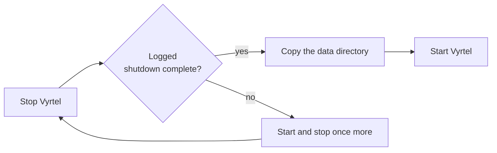

# Backups and upgrades

Everything Vyrtel keeps (telemetry, dashboards, alerts, saved queries, users and API keys) is in
one data directory. To back it up, copy the directory. To restore, put the copy back.

## Back up



```bash
docker stop vyrtel
docker run --rm -v vyrtel-data:/data -v "$PWD":/backup busybox \
  tar -C /data -czf /backup/vyrtel-$(date +%F).tar.gz .
docker start vyrtel
```

For a binary install, stop the service and `tar` the `--data-dir` directory.

To back up **without stopping**, take an atomic filesystem or volume snapshot (LVM, ZFS,
btrfs, or a cloud disk snapshot). Never copy the files one by one while Vyrtel runs.

Back up your configuration file and environment variables separately. They are not in the
data directory.

## Restore

1. Stop Vyrtel and move the current data directory aside.
2. Unpack the backup in its place. For Docker bind mounts, make it owned by uid 65532.
3. Start Vyrtel. Each signal logs a `recovered stream` line.
4. Check that recent data shows up in the UI.

The restored admin user keeps its password unless you set a new one.

## Upgrade

1. **Stop** the old version and check that it logged `shutdown complete`.
2. **Check** that the new version can read your data, without changing anything:

   ```bash
   docker run --rm -v vyrtel-data:/data ghcr.io/rowan-smith/vyrtel:<new version> check-data-dir
   ```

3. **Back up** the data directory.
4. **Start** the new version on the same directory, and check that `GET /ready` returns `200`.

Before 1.0, a release can change the storage layout. If `check-data-dir` says the new version
cannot start your data directory, stay on your current version or start the new one on a fresh
directory. The release notes say when this applies.

Producers that buffer and retry, such as OpenTelemetry SDKs and the Collector, resend whatever
they couldn't deliver while Vyrtel was stopped.

## Reference

- [Backup and restore](../configuration.md#backup-and-restore): what each file holds, startup
  checks and the restore drill
- [Stopping and upgrading](../configuration.md#stopping-and-upgrading): shutdown, grace periods
  and exit codes
- [Upgrading between pre-1.0 releases](../configuration.md#upgrading-between-pre-10-releases)
- [Crash recovery](../configuration.md#crash-recovery-and-backups)
