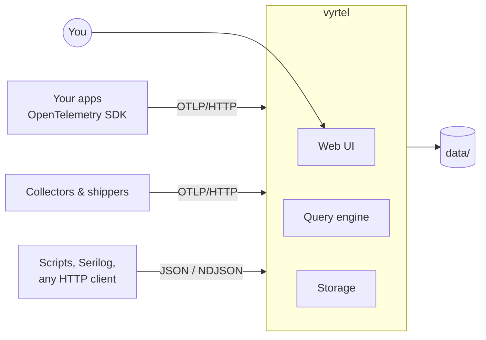

# Introduction

Vyrtel is a self-hosted server for structured logs, traces and metrics. It is a single binary
with the web UI built in, and it keeps everything in one data directory. You don't need a
database, a message queue or a search cluster to run it.

## What you get

| | |
|---|---|
| **Logs** | Structured search, live tail, a filter panel built from your fields, exceptions and stack traces |
| **Traces** | Waterfall view, span details, and the logs for each trace |
| **Metrics** | Counters, gauges and histograms, aggregated and grouped over time |
| **Dashboards** | Log counts, metric lines, single stats and saved queries on one grid |
| **Alerts** | Log-count thresholds with state history and webhook delivery |
| **Ingestion** | OTLP/HTTP (protobuf or JSON) and plain JSON/NDJSON, including Serilog CLEF |

## Who it is for

Vyrtel suits teams, side projects and single services that want good log search and basic
tracing without operating a monitoring stack. It runs on one node and grows with the machine
it runs on. Multi-node deployments are on the [roadmap](../roadmap.md).

## Where to go next

- **[Quickstart](quickstart.md)**: run Vyrtel, send an event and query it in about five minutes.
- **[Installation](installation.md)**: binaries, Docker and building from source.
- **[Send data with OpenTelemetry](opentelemetry.md)**: point an SDK or Collector at Vyrtel.
- **[Query language](../query-language.md)**: everything the search box understands.

## Current limits

- One node. There is no replication or clustering yet.
- OTLP over HTTP only. gRPC is not supported.
- `message contains` scans messages, because there is no full-text index yet. Regex and
  wildcards are not supported.
- Metrics aggregate raw data points. There is no `rate()` and there are no percentiles yet.
- Vyrtel serves plain HTTP. Put it behind a reverse proxy for TLS ([security](security.md)).
