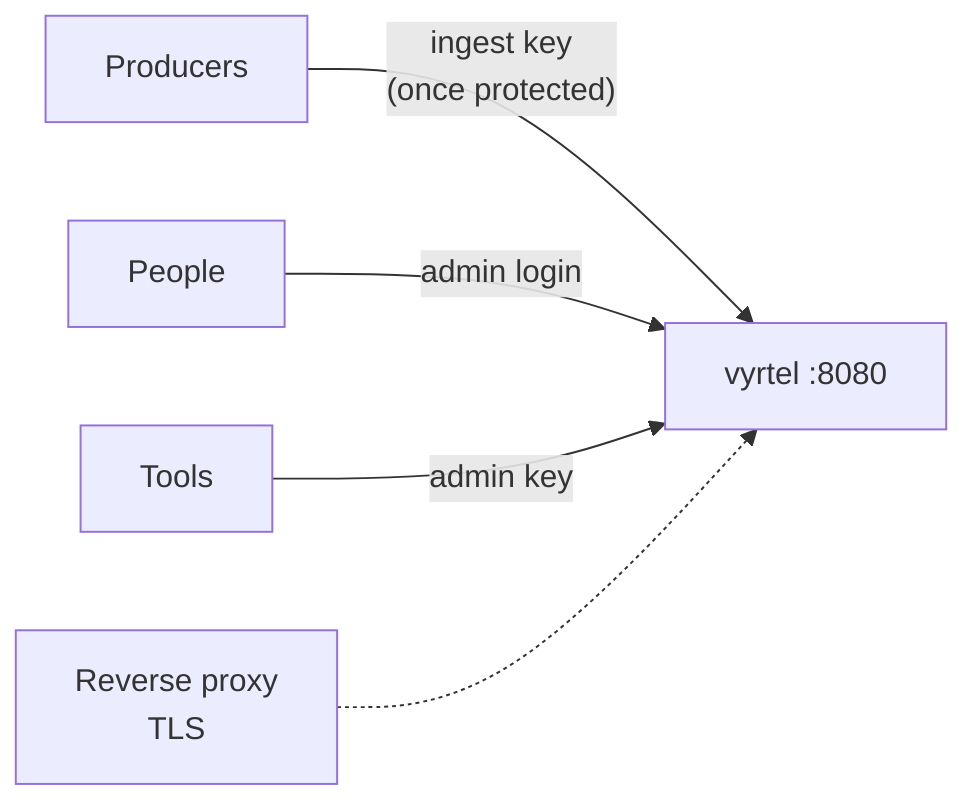

# Security

Vyrtel has three things to secure: the UI and API, ingestion, and the connection itself.

## The UI and API

The UI and API always need a login or an admin API key.

- On first start, Vyrtel creates the `admin` user and prints a random password once.
- To choose the password yourself, set `VYRTEL_AUTH_ADMIN_PASSWORD` (or `auth.admin_password`).
  Starting with a different password signs out every existing session.
- Sessions last 7 days by default (`auth.session_ttl`).

## Protect ingestion

A new install accepts events without a key, so that you can try it immediately. **Create an
ingest key before anything outside a trusted network can reach the port.**

1. Open **Settings → API keys** and create a key with the **ingest** scope.
2. Copy the key. It is shown only once, and Vyrtel stores only a hash of it.
3. Configure producers to send it as `Authorization: Bearer <key>` or `X-Api-Key: <key>`.

Once the first ingest key exists, ingestion requires a key for good. Revoking keys or
restarting does not open it again. The ingestion mode, also under Settings → API keys, can
change that:

| Mode | Ingestion |
|---|---|
| `automatic` (default) | Open until the first ingest key is created, then protected |
| `required` | Protected from the start, even before any key exists |
| `open` | Accepts every request without a key. Use only on a trusted network |

Admin keys can do everything an ingest key can, and also call the rest of the API. Give
producers ingest keys only.

## TLS

Vyrtel serves plain HTTP. To expose it, put it behind a reverse proxy such as Caddy, nginx or
Traefik, or a cloud load balancer, and terminate TLS there.

## Backups contain secrets

A backup of the data directory holds password and key hashes, session tokens (hashed) and
alert webhook URLs. Store backups like credentials. See
[Backups and upgrades](backups-and-upgrades.md).

The details are in [configuration: ingestion authentication](../configuration.md#ingestion-authentication)
and the [authentication API](../api.md#authentication).
