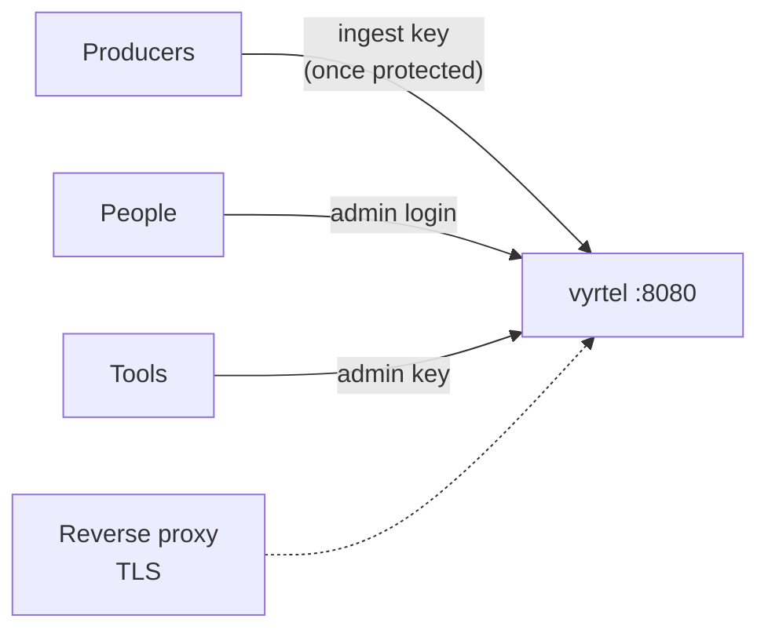

# Security

Vyrtel has three things to secure: the UI and API, ingestion, and the connection itself.

## The UI and API

The UI and API always need a login or an admin API key.

- On first start, Vyrtel creates the `admin` user and prints a random password once, in the
  startup banner on standard output. It is never logged or shown again, and there is no default
  password ([the first administrator](../configuration.md#the-first-administrator)).
  Docker, Kubernetes and systemd may keep standard output in their logs, so restrict access to
  startup output, or set the password yourself when others can read those logs.
- To choose the password yourself, set `VYRTEL_AUTH_ADMIN_PASSWORD` (or `auth.admin_password`).
  An empty value, or the username itself, stops startup.
  Starting with a different password signs out every existing session.
  This is also how to recover the account if the password is lost. Restarts without it keep
  whatever password the account last had.
- The UI shows only the sign-in form until you log in, and the server checks every query and
  admin request itself, whatever the browser does.
- Usernames are case-insensitive, and passwords are stored only as salted Argon2id hashes
  ([local accounts](../configuration.md#local-accounts)).
- Sessions last 7 days by default (`auth.session_ttl`). Changing it applies to new logins;
  existing sessions keep the expiry they were issued with.
- Every login issues a new session and ends the one the browser was using. Other devices stay
  signed in until they sign out, the account's password is changed or reset, or the account is
  deactivated. Each account keeps at most 32 sessions; a 33rd login ends the oldest
  ([sessions](../configuration.md#sessions)).

## Protect ingestion

A new install accepts events without a key, so that you can try it immediately. **Create an
ingest key before anything outside a trusted network can reach the port.**

1. Open **Settings → API keys** and create a key with the **ingest** scope.
2. Copy the key. It is shown only once, and Vyrtel stores only a hash of it.
3. Configure producers to send it as `Authorization: Bearer <key>` or `X-Api-Key: <key>`.

Once the first ingest key exists, ingestion requires a key for good. Revoking keys or
restarting does not open it again. The ingestion mode, also under Settings → API keys, can
change that:

| Mode | Ingestion |
|---|---|
| `automatic` (default) | Open until the first ingest key is created, then protected |
| `required` | Protected from the start, even before any key exists |
| `open` | Accepts every request without a key. Use only on a trusted network |

Admin keys can do everything an ingest key can, and also call the rest of the API. Give
producers ingest keys only.

## TLS

Vyrtel serves plain HTTP. To expose it, put it behind a reverse proxy such as Caddy, nginx or
Traefik, or a cloud load balancer, and terminate TLS there.

## Backups contain secrets

A backup of the data directory holds password and key hashes, session tokens (hashed) and
alert webhook URLs. Store backups like credentials. See
[Backups and upgrades](backups-and-upgrades.md).

The details are in [configuration: ingestion authentication](../configuration.md#ingestion-authentication)
and the [authentication API](../api.md#authentication).
