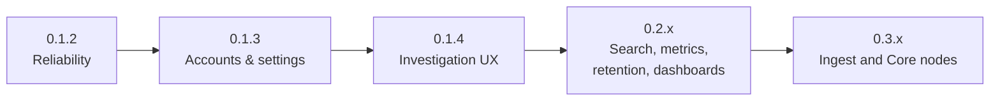

# Roadmap

Planned work is tracked in [GitHub milestones](https://github.com/rowan-smith/Vyrtel/milestones)
and on the [project board](https://github.com/users/rowan-smith/projects/2), which have the live
status. This page summarises them. Versions have no dates, and planned items aren't promises.

**Latest release:** [0.1.1](https://github.com/rowan-smith/Vyrtel/releases/latest).
**In progress:** 0.1.2, reliability and release confidence.

## Milestones

| Version | Focus |
|---|---|
| [0.1.2](https://github.com/rowan-smith/Vyrtel/milestone/1) | **Reliability and release confidence.** Bounded ingestion, crash recovery, backup and restore, query budgets, graceful shutdown, validated releases. |
| [0.1.3](https://github.com/rowan-smith/Vyrtel/milestone/2) | **Accounts, settings and operational foundations.** Named local accounts, sessions and password changes, scoped API keys, profile and settings pages, retention settings, storage paths. |
| [0.1.4](https://github.com/rowan-smith/Vyrtel/milestone/13) | **Investigation workflows and UI polish.** Stable live and paused history, shareable query URLs and saved searches, a shared search bar, pinned columns, .NET and Collector quickstarts. |
| [0.2.0](https://github.com/rowan-smith/Vyrtel/milestone/3) | **Indexed log queries and guided filtering.** Optional exact and message indexes, plain-text search, field and value suggestions, grouping and time buckets, a guided filter builder. |
| [0.2.1](https://github.com/rowan-smith/Vyrtel/milestone/4) | **Metrics, interoperability and SQL.** Metric rates and percentiles, OTLP/gRPC, native clients and a Serilog adapter, read-only SQL. |
| [0.2.2](https://github.com/rowan-smith/Vyrtel/milestone/5) | **Retention and alert operations.** Selective retention, reliable notification delivery and retries, destinations, maintenance silences. |
| [0.2.2](https://github.com/rowan-smith/Vyrtel/milestone/10) | **Privacy and user audit trails.** PII masking before data is stored, and an application audit log. |
| [0.2.3](https://github.com/rowan-smith/Vyrtel/milestone/6) | **Dashboard investigation workflows.** Dashboard editing, multi-series charts, shared filters and time ranges, drill-downs, import and export. |
| [0.2.4](https://github.com/rowan-smith/Vyrtel/milestone/11) | **Security investigation workflows.** Security-event mappings, a starter dashboard and alert recipes. |
| [0.3.0](https://github.com/rowan-smith/Vyrtel/milestone/8) | **Ingest and Core node foundation.** One binary that runs all-in-one, or as stateless Ingest nodes forwarding to one Core. |
| [0.3.1](https://github.com/rowan-smith/Vyrtel/milestone/9) | **Multi-node operational hardening.** Role-aware health checks, deployment and upgrade runbooks, compatibility checks. |

## Under investigation

These are research items with no release commitment:

- [Discovery and architecture decisions](https://github.com/rowan-smith/Vyrtel/milestone/7):
  object-storage tiering, replication and high availability, OIDC and RBAC, email notifications.
- [Storage evolution experiments](https://github.com/rowan-smith/Vyrtel/milestone/12): adaptive
  storage and indexing for repetitive logs, each released only if it beats measured targets.

## Compatibility before 1.0

Before 1.0, a release may change the storage layout. A new release refuses data directories it
can't read, without changing them, and the release notes say what to do. See
[Backups and upgrades](guide/backups-and-upgrades.md) and the
[compatibility policy](../CONTRIBUTING.md#compatibility-policy-before-10).
